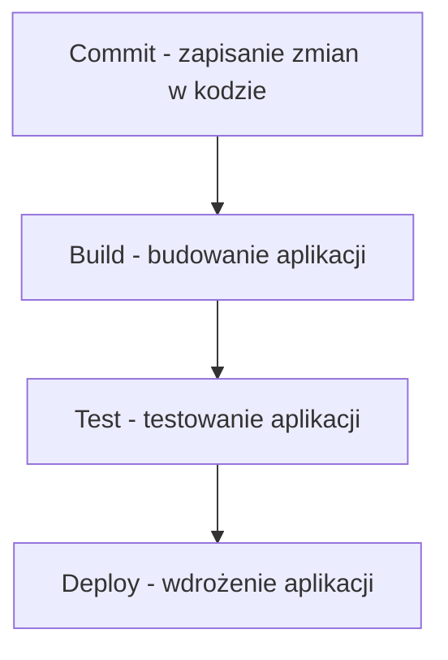

# Zadanie 6: Pierwszy diagram Mermaid

## 1. Prompt

```text
Stwórz prosty diagram Mermaid pokazujący proces CI/CD:
commit → build → test → deploy.
```

## 2. Kod Mermaid



## 3. Opis diagramu

Diagram przedstawia podstawowy proces CI/CD (Continuous Integration / Continuous Deployment), czyli ciągłej integracji i wdrażania aplikacji.

Proces składa się z czterech etapów:

1. **Commit** – programista zapisuje zmiany w kodzie i przesyła je do repozytorium.
2. **Build** – system automatycznie buduje aplikację na podstawie aktualnego kodu.
3. **Test** – aplikacja przechodzi testy sprawdzające poprawność działania.
4. **Deploy** – po pomyślnym zakończeniu wcześniejszych etapów aplikacja zostaje wdrożona.

Diagram został przygotowany w języku Mermaid i sprawdzony w Mermaid Live Editor.

## 4. Zrzut ekranu

Diagram można zobaczyć w Mermaid Live Editor:
https://mermaid.live/edit#pako:eNp1jcFugzAMhl8l8hkqWsga5TBphUfoadBDRlyalSQoJKKl6pvtuvdaitRJO8wX278-f75BayUCh2Nvp_YknCf7qnGNIbHe6tJqrTxJySwGNQqjkMxaCUMmcrZyVnggafpKdvUuqF5G7iNIOy2cGHp1Fu2nOjx1u4Ut6z2OD6WP7V-2XNiqrnDo7TXSk3T2-wv_0pBA55QE7l3ABDQ6LR4r3B6WBvwJNTbA4-hQhksqhTunre2ta6Ax93g_CPNurX4qnA3dCfhR9GPcwiCFx0qJzgn9mzo0El1pg_HA18XiAH6DC_ANo6uXjG5YRovtmjKawBV4nsUwz7NtsVkzxmhB7wnMy9dsxbb0_gMbIX0n

Zrzut ekranu wygenerowanego diagramu należy umieścić w repozytorium i dodać do dokumentacji (opcjonalnie jako osobny plik graficzny).